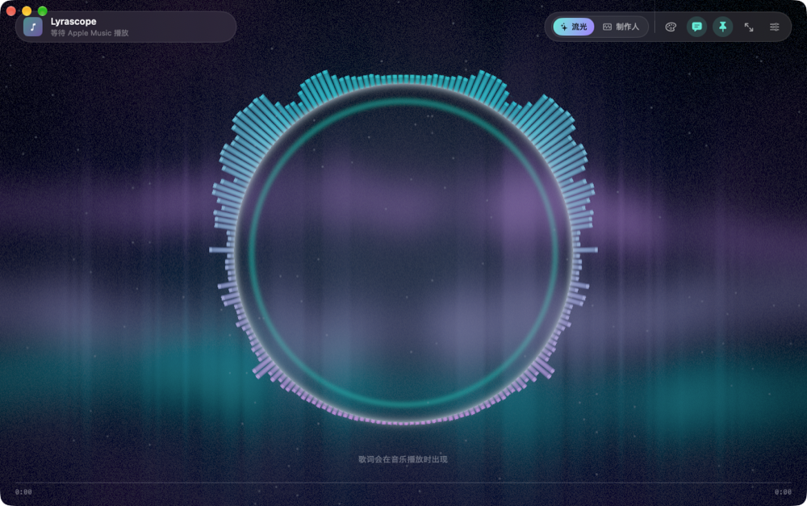
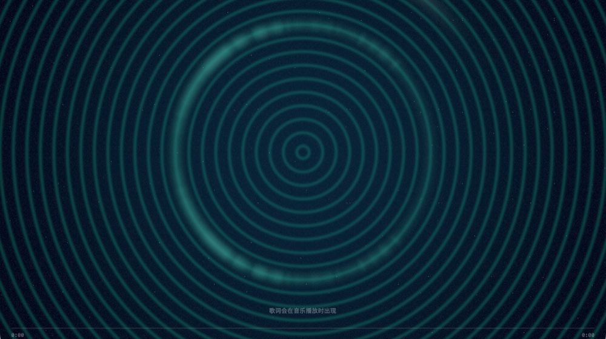
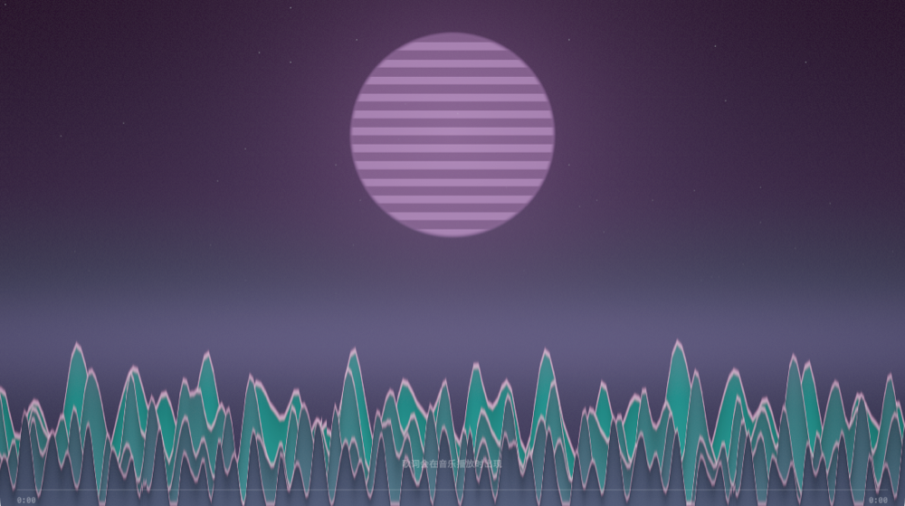
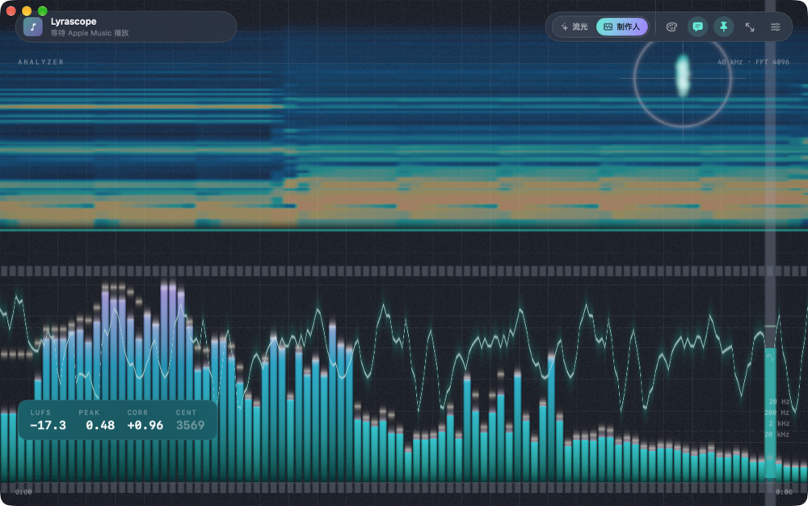

# Lyrascope · 词镜

> 让 Apple Music 有画面，也有歌词。

[](https://github.com/ThecangShengdance/Lyrascope/actions/workflows/build.yml)
[](https://github.com/ThecangShengdance/Lyrascope/releases)
[](LICENSE)

Lyrascope 是一个用 Swift + SwiftUI + Metal 写的 macOS 音乐可视化与歌词悬浮工具。它不读取你的音乐库文件，而是通过 **Core Audio 进程 Tap（系统录音）** 实时分析正在播放的声音，把频谱、波形、声像与响度画成画面，并把带时间轴的歌词悬浮在桌面上或放进菜单栏。

- 五种画面：**流光**（极光 + 频谱环）、**棱镜**（无限隧道）、**涟漪**（水面波纹）、**峰峦**（声波山脉 + 落日）与 **制作人**（瀑布频谱、示波器、声像仪、LUFS 表）。
- 三种形态：**窗口** / **全屏** / **菜单栏**，随时切换。
- 歌词：**桌面悬浮歌词**（逐字高亮、可拖动、可鼠标穿透）+ **菜单栏歌词**（逐字变色，唱到哪字哪个字亮；弹窗里还有当前行进度条）。
- 隐私：所有分析都在本机完成，不录音、不上传、不需要麦克风。

<!-- 截图放在 Docs/assets 下，构建时不会打进 app -->






## 下载

到 [Releases](https://github.com/ThecangShengdance/Lyrascope/releases) 下载 `Lyrascope.zip`，解压后把 `Lyrascope.app` 拖进「应用程序」。

首次打开会被 Gatekeeper 拦一次（ad-hoc 签名，没有公证）：

```bash
xattr -cr /Applications/Lyrascope.app
```

然后到 **系统设置 → 隐私与安全性 → 屏幕与系统录音** 里允许 `Lyrascope.app`，重新打开即可。

---

## 环境要求

| 项目 | 要求 |
| --- | --- |
| macOS | 14.2 或更新（进程 Tap API 从 14.2 开始提供） |
| 芯片 | Apple Silicon 或 Intel（Metal 2 以上） |
| Xcode | 16 或更新（本仓库用 Xcode 27 验证） |
| 第三方依赖 | **无**。没有 SPM / CocoaPods / 任何 vendored 代码 |

> 变更记录见 [CHANGELOG.md](CHANGELOG.md)。

## 构建

```bash
# 在 Finder 里打开工程
open Lyrascope.xcodeproj

# 或用脚本直接产出 Dist/Lyrascope.app（ad-hoc 签名，可直接双击运行）
./scripts/build.sh
```

脚本等价于：

```bash
xcodebuild -project Lyrascope.xcodeproj -scheme Lyrascope \
  -configuration Release -derivedDataPath .build/dd build
```

> 如果把仓库放在沙箱受限的目录里构建，Swift 宏插件可能因为 `sandbox_apply` 失败而报错，可以在命令行临时加 `OTHER_SWIFT_FLAGS='$(inherited) -disable-sandbox'`。工程文件本身不写这个参数，在 Xcode 里正常构建不受影响。

## 首次运行

1. 启动后会提示授权「屏幕录制」——系统录音需要这项权限，macOS 把它归在屏幕录制里。
2. 在 Apple Music 里播放任意歌曲，画面应当立即响应。
3. 第一次弹出歌词时，可能需要允许 Lyrascope 访问「自动化」，用于读取 Music 的本地歌词与播放状态。

如果没有声音：打开 `设置…（⌘,）→ 音频` 点「重新连接」，或到「系统设置 → 隐私与安全性 → 屏幕录制」里确认 Lyrascope 已勾选（勾选后需要重开 App）。

## 功能一览

### 画面

| 视图 | 内容 |
| --- | --- |
| 流光 | 极光帘幕 + 圆周频谱柱 + 峰值帽 + 节拍呼吸 + 星尘 + 暗角，颜色随强调色变化 |
| 棱镜 | 无限延伸的隧道：频谱化作一圈圈推进的环，96 根辐条随频段明暗 |
| 涟漪 | 深色水面，细密同心波纹随低频荡开，一圈频谱光带随角度起伏 |
| 峰峦 | 四层声波山脊 + 条纹落日 + 星尘，山脊轮廓由波形驱动 |
| 制作人 | 上半屏频谱瀑布（热力图）、下半屏柱状频谱 + 峰值帽 + 示波器 + 声像仪 + LUFS 电平条与 -14 LUFS 目标线 |

- 强调色：极光 / 鎏金 / 冰蓝 / 单色。
- 光晕强度、背景压暗、渲染帧率（60 / 30 fps）、自动隐藏控件均可调。
- 频谱做了逐帧自适应对比度：安静的段落不会糊成一片，鼓点与高频也更明显。
- 没有声音时自动降到 30 fps 省电；窗口被完全遮住或最小化时暂停渲染。
- 掉帧或没有 Metal 时自动退回 SwiftUI Canvas 版本。

### 歌词

歌词来源按顺序尝试，前一个没有结果才继续：

1. 你指定的本地 `.lrc` 文件夹（按「歌名 - 歌手.lrc」匹配，可附带 `.trans.lrc` 翻译文件）
2. 本地缓存（`~/Library/Application Support/Lyrascope/Lyrics`）
3. [LRCLIB](https://lrclib.net) 社区歌词库（可关闭）——**带时间轴的版本优先**
4. Apple Music 里本地歌曲自带的歌词（通过 AppleScript 读取）

几个细节：

- 只有纯文本、没有时间轴的歌词不再「只显示第一句」：会按曲长铺一条估算时间轴，跟着音乐往下走（主界面会标注「时间轴按曲长估算」）。
- 如果歌词本身没有翻译，可以用系统「翻译」框架在本机补一份（设置 → 歌词 → 自动翻译，默认开启）。翻译只在本机内存与本地缓存里，不联网、不写回歌词文件。
- 支持 LRC 的逐行与逐字时间轴、翻译行、`[offset:]` 与界面里的手动偏移。

> 流媒体曲目的歌词受版权保护，Lyrascope 不会去抓取 Apple Music 的在线歌词。能拿到就显示，拿不到就安静地留白。

### 形态

- **窗口**：1180×740 起，可缩放；记住位置。
- **全屏**：`⌃⌘F`，进入后控制条自动淡出，适合投屏。
- **菜单栏**：状态栏图标本身就是 5 根跳动的柱子，旁边的歌词逐字变色；点开是迷你播放器 + 歌词（含行内进度条）+ 快捷开关；右键有菜单。
- **仅菜单栏**：隐藏 Dock 图标与主窗口，只留菜单栏。

### 快捷键

| 快捷键 | 动作 |
| --- | --- |
| `⌥⌘L` | 显示 / 隐藏桌面歌词 |
| `⌥⌘F` | 全屏 |
| `⌥⌘V` | 切换到下一个视图 |
| `⌥⌘M` | 显示主窗口 |
| `⌘1` – `⌘5` | 切到第 1–5 个视图 |

## 权限与隐私

| 能力 | 用途 | 数据去向 |
| --- | --- | --- |
| 屏幕录制（系统音频） | 实时拿到混音后的系统声音做 FFT | 只在本机内存里，不落盘 |
| 自动化（Music） | 读取当前曲目与本地歌词 | 只调用本机 Music |
| 网络（可选） | 向 LRCLIB 查询歌词 | 只发送「歌名 / 歌手 / 专辑 / 时长」，不发音频 |
| 系统翻译（可选） | 歌词没有翻译时在本机生成 | 由系统框架处理，App 不保存正文以外的内容 |

- 没有麦克风权限请求，也不会打开麦克风。
- 没有统计、没有账号、没有崩溃上报。
- App Sandbox 关闭（进程 Tap 与 AppleScript 需要），因此签名用 ad-hoc；分发到其他机器时需要自己的开发者证书。

## 目录结构

```
Lyrascope/
├── Lyrascope.xcodeproj        # objectVersion 77，文件系统同步分组
├── Sources/
│   ├── App/                   # 入口、AppDelegate、窗口管理、热键、菜单、自检
│   ├── Core/                  # 音频采集 / 分析 / 正在播放 / 歌词 / 设置
│   ├── Design/                # 主题与通用控件
│   ├── Views/                 # 主界面、桌面歌词、菜单栏面板、设置、引导
│   ├── Visuals/               # Metal 渲染器 + 内嵌着色器源码
│   └── Resources/             # Assets.xcassets（图标）
├── Docs/                      # 架构、许可审查、截图
└── scripts/                   # build.sh、make_icon.swift
```

更细的模块划分与数据流见 [Docs/ARCHITECTURE.md](Docs/ARCHITECTURE.md)。

## 自检

```bash
"Dist/Lyrascope.app/Contents/MacOS/Lyrascope" --selftest
```

会跑 18 项检查：LRC 解析、纯文本歌词的估算时间轴、翻译合并、采样率/频段、K 加权响度（1 kHz 正弦应得 ≈ -9 LUFS）、立体声相关性、Metal 着色器运行时编译等，最后以退出码 0/1 结束，不启动界面。

## 许可与合规

- 本仓库代码为原创，以 [MIT](LICENSE) 发布。
- 不包含任何 GPL / AGPL / LGPL 代码，没有任何第三方依赖。完整审查见 [Docs/LICENSE-AUDIT.md](Docs/LICENSE-AUDIT.md)。
- 名称「Lyrascope」经过 App Store 与 GitHub 检索，未发现同名软件；如与他人商标冲突，请改名后使用。
- 歌词版权归各自权利人所有，本 App 只做本机展示，不提供歌词下载或再分发。

## 已知限制

- 只能看到系统正在播放的混音，无法分离单个 App 的音轨（想做分轨要在 Tap 上按进程拆分）。
- 媒体信息通过 MediaRemote 读取，属于私有框架；macOS 更新后可能失效，失效时会退回 AppleScript。
- Apple Music 的在线歌词无法读取，这是有意为之。
